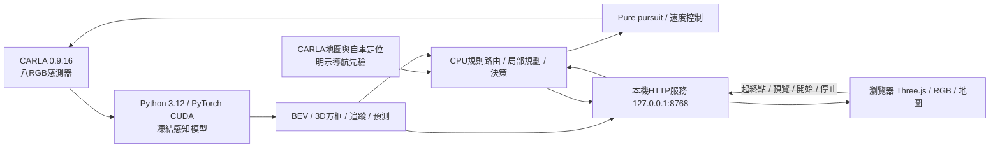

# 模型部署與展示方式

## 直接分享的網頁展示

公開展示入口：[W·DRIVE GitHub Pages](https://annahung306.github.io/senior-ai-driving-demo/)。已將一段成功的28m行人避讓路線整理為純靜態網站，支援67影格／八鏡頭／3D旋轉／播放與逐幀，含16:9影片；觀眾不需GPU或CARLA。完整開啟、GitHub更新及註解導覽見[WEB_DEMO.md](WEB_DEMO.md)。

從乾淨clone於專案根目錄執行 `python -m http.server 8080 --directory docs`，再開啟 `http://localhost:8080/` 即可回放，不需pip／npm套件。以下章節說明完整本機模型／模擬器部署；線上靜態展示不執行新的模型推論或駕駛控制。

## 現在部署在哪裡

目前是**本機 Windows／RTX4070 Laptop 的研究部署**，不是將整個模型裝進網頁。Phase10已完成更廣稽核：原六條新路線2/6抵達，無GT循環p50約1.19秒，正式可靠性與即時品質仍未通過，詳[PHASE10.md](PHASE10.md)及[問題清單](PHASE10_ISSUES.md)。本輪測試服務與CARLA交付前均已停止。

`src/senior_ai/live_perception.py`在每次駕駛job載入並保持四種凍結權重：MobileUNet v6道路／語意分割、Faster R-CNN MobileNetV3 FPN v6偵測、LightStateNet號誌狀態、Phase5 RGB crop 3D head。PyTorch在GPU執行；BEV幾何、WorldTracker、Phase7 Kalman／CV預測及Phase8–9規則規劃與控制在CPU執行。權重的SHA會先核對；這輪沒有重新訓練或將規則方法稱為學習式規劃。

地圖、起終點與自車pose／speed來自CARLA導航／定位介面。**其他車輛／行人位置、未來狀態與號誌真值沒有傳給主規劃器**。受控交通測試可由獨立director擺放車輛或切換號誌，必須明示是測試環境；自車仍讀RGB決策。主網頁的物件與道路來自模型，導航線是地圖規劃結果。

## 怎麼展示

| 方式 | 操作 | 適合用途 |
|---|---|---|
| 本機閉環 | `./Start-NavigationDemo.ps1 -StartSimulator`，開啟`http://127.0.0.1:8768/` | 操作起終點，觀察真實模擬器影像→推論→控制；需要GPU與CARLA |
| 已啟動CARLA | `./Start-NavigationDemo.ps1` | 檢查／載入Town01，再啟動導航服務；不能有第二個控制器 |
| 純錄製展示 | `./Start-NavigationDemo.ps1 -ReplayOnly` | 不連CARLA、不載入GPU模型，載入已保存run；以模擬時間播放或逐幀查看 |
| Phase7感知展示 | `./Start-WorldViewer.ps1`，8766 | 既有四序列速度／風險及三視角；不控制車輛 |
| 展示影片 | [已錄製的16:9實際回放](evidence/phase10/system-audit-v1-001/video/phase10-focus-replay.webm)，13.4秒／1280×720 | 真67幀行人案，明標錄製與地圖先驗；5FPS模擬時間回放，非即時推論 |
| 外部電腦／公開網站 | 另部署GPU後端、認證與TLS／代理；或只發布無控制的錄製資料展示 | 尚未公開部署；不能只把HTML放一般靜態網站就運行CARLA／CUDA |

現在的自訂選點範圍是Town01可連通道路節點，地圖點選會吸附到可選spawn節點，下拉選單也能選。路線先預覽，長度8–600m且連續有效才可啟動。固定測試路線可能使用兩節點之間的內插終點，實際終點以預覽地圖標記為準。**能建立路線不表示任意路線都能可靠抵達**；模型品質及通行情況仍可能令車輛保守停止。

同台電腦以HDMI／螢幕分享投影即可展示。瀏覽器可維持流暢渲染，但本機八鏡頭模型運算約秒級，使用同步模擬逐輪推進，實際牆鐘行駛較慢；錄製回放可以按原模擬時間播放。不要把render FPS或回放速度當成模型即時推論速度。

## 操作流程

1. 啟動前確認沒有訓練、其他駕駛或CARLA tick client；即時駕駛須有本機已核准模型及CARLA，預設路線catalog已存於configs。重新做訓練軌跡稽核／選例才需原007資料，live駕駛直接讀新相機影像。
2. 開啟8768，選兩個道路節點，或選固定驗證路線；按「預覽可連通路線」。
3. 確認路線後按「開始駕駛」；右側地圖看位置，左側看RGB推論路面／物件與局部導航計畫，下方可切八鏡頭。
4. 按「停止／全煞車」會要求目前推論返回後停止。同步模擬在推論期間不持續前進。停止後等待清理完成才開下一輪。
5. 到「完成紀錄」載入run，按播放或拖曳時間軸；回放明標不控制車輛。
6. 先停止駕駛，再以Ctrl+C停止服務；若CARLA由本專案啟動，可用`./scripts/stop_carla.ps1`停止。

Phase10增加3秒viewer heartbeat lease；關頁／WebGL失效送取消，beacon加fetch是best effort。實際移動後無心跳約4.39秒、真關頁約4.40秒完成停止清理，包含當輪推論與收尾；並非即時硬體急停。瀏覽器背景節流／斷線可能觸發保守停止，展示時保持頁面開啟。同步模擬在等待推論時不持續推進。

中斷恢復工具`cleanup_phase89_owned.py`只清除role_name為本專案的actors。`--restore-orphaned-sync`只能在確認舊worker已退出後使用，不能在仍有控制器時重設同步設定。完整原始RGB／逐幀record與run報告保存在ignored `artifacts/runs/phase89-drive-*`；Git證據不包含全部大型影像或權重。

純回放的I/O已與Torch／CARLA匯入分離，服務啟動不載入兩者；移到沒有GPU的電腦時，仍須複製本專案source、configs、web及指定run整個資料夾（含PNG），準備Python3.12，使用`requirements-navigation-viewer.txt`安裝NumPy及Pillow，再執行`python scripts/serve_navigation.py --replay-only`。Git封存未包含全部PNG，單靠Git無法播放完整原影像。若要改成純靜態公開網站，還需將這些run整理為公開資料資產；本輪沒有上傳或公開控制服務。

## 可攜式回放包（已實測）

最新本機ZIP：`artifacts/runs/phase10-portable-replay-v1-001.zip`（139,595,970 bytes，約133.1MiB，SHA256 `f58cf9fe10732f47ec94fd002be0862e6654ed34b9bc20ed5a6fdad6157f3a27`）。解壓到任意新資料夾，依其中README以Python3.12安裝`requirements-navigation-viewer.txt`，執行`python scripts/serve_navigation.py --replay-only`，開啟`http://127.0.0.1:8768/`。內含Phase89真橫穿行人案64影格／512張RGB、保存的模型結果與地圖；新版可拖曳旋轉3D及reset、播放、seek及對照八鏡頭，禁止起車。

新版在獨立資料夾／8770實際驗證：609個manifest檔案SHA（另加manifest自身共610檔）、八RGB、回放影格121465、409拒絕起車，以及從該包匯入服務未載入Torch／CARLA。ZIP有CRC與SHA收據，沒有上傳。權重與完整訓練資料不需要放入此展示包；它是保存結果回放，無法在沒有GPU／CARLA時執行新的駕駛。包裝後主頁另有new-job空摘要小修，該包只回放、不啟動job，保存版本hash與主目錄不同是明示的。

舊 `phase89-portable-replay-v1-001.zip` 139,590,759bytes／607項manifest仍原樣保留。舊文件曾稱該ZIP可旋轉，當時其實未提供Orbit操作；Phase10新版才加入並實際驗證，未改寫舊證據或舊ZIP。

## 目前能力界線

採用晴天、平坦且無近牆的理想環境；路口號誌／物件仍可能漏檢、車輛常錯類、三維朝向不準，路面支持也可能不足，失敗會記錄並停止。局部候選僅限同車道小幅側移，沒有經驗證的任意超車／換道，也不具備全域保證避碰能力。未通過的動態交通及任意路線可靠性須保留；最新實測與完成矩陣以[PHASE10.md](PHASE10.md)為準。
