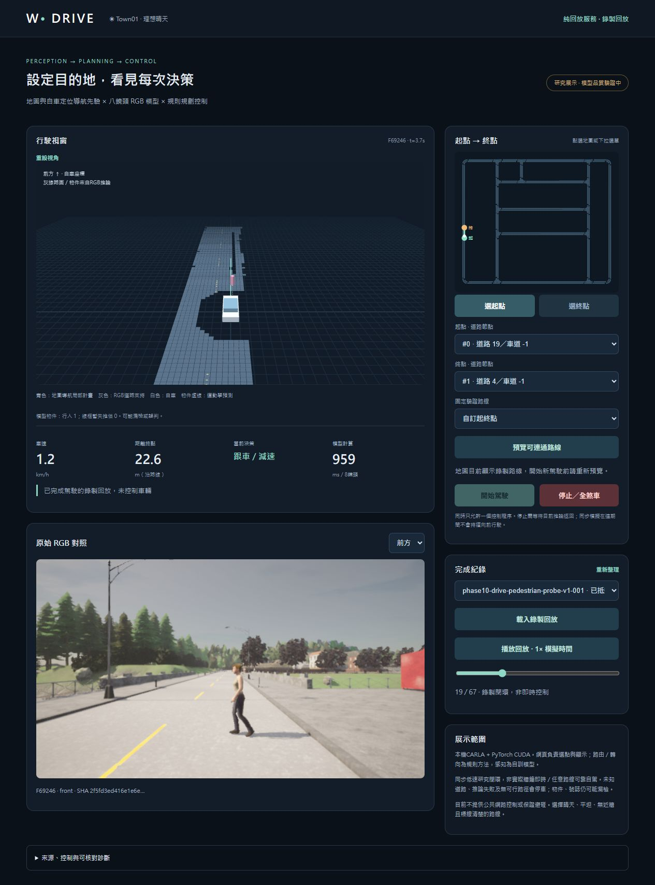
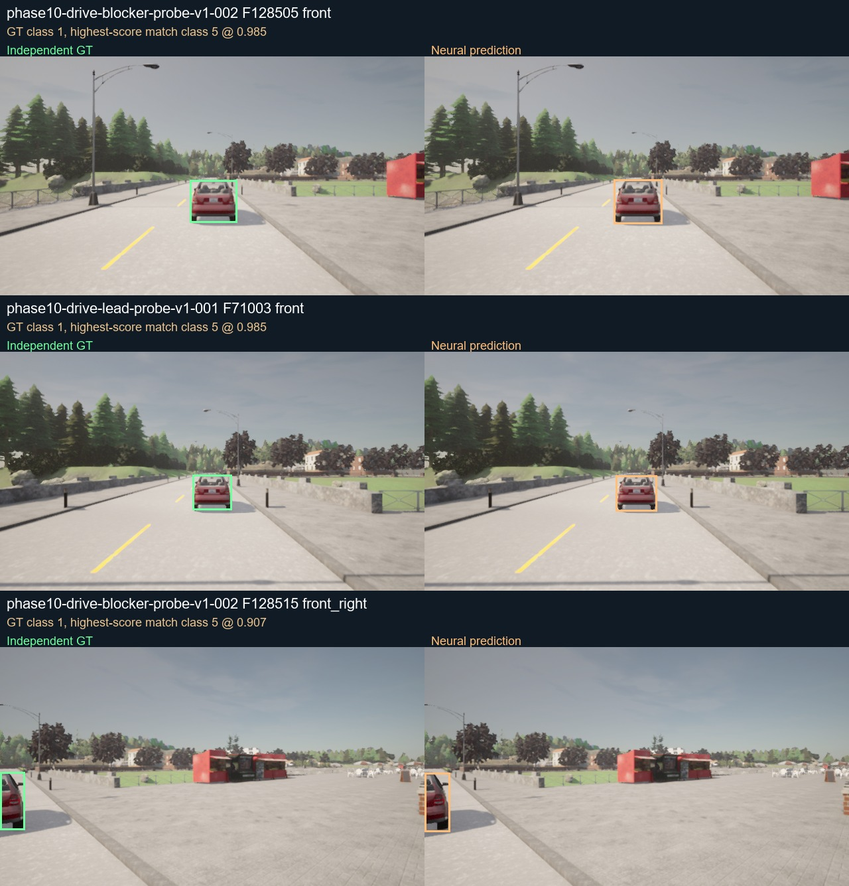

# Phase10：系統稽核與工程修復（2026-10-21）

**稽核交付完成，正式模型／駕駛品質仍未通過。** [完整報告](REPORT.md)、[24項問題登錄](PHASE10_ISSUES.md)、[部署與展示](DEPLOYMENT.md)。

- 預先固定六條新路線只有2/6抵達，失敗及逾時原樣保留；五個受控修復回歸抵達不改寫原分母。全部24次attempt含儀器錯誤、setup故障與七次web取消，共23個非空run、2194record、17552RGB。
- 獨立八instance camera／capture snapshot只進audit，393組八視角／3144影像。2D road IoU98.06%，car/truck錯類與號誌漏檢嚴重；3D IoU.25 Recall2/51=3.92%、yaw MAE51.27°；2秒預測覆蓋14/41。不能以條件均值或高road IoU代表閉環通過。
- 修復finite gate、曲路障礙、紅燈stall、Windows鎖檔、GT bbox／setup清理、RGB／preview競態、3秒viewer lease及契約。322 Python、52 JS、27真HTTP；全部2194幀自身凍結planner/control重算與1338個真Three cuboid，最終67browser幀／83物件／64forecast來源一致。
- cache真同輸入fusion陣列exact，該段516.02→78.63ms；PNG paired快45.15%但size×1.555。noGT total p50 1193.94ms超過200ms預算，active RAF p95 41.735ms仍有長幀；200% browser zoom與長時間洩漏測試未驗收。
- 四權重未變、不訓練／不裝新套件、不開舊dev／lockbox、不補Wall／depth；沒有公開上傳。交付前world async且actors0，再停止CARLA及本輪所有服務，連接埠無listener。

[16:9實際錄製回放影片](video/phase10-focus-replay.webm)：1280×720、67幀、5FPS、13.4秒；實際browser解碼播放。明標recorded/not live及地圖先驗，影片有損，不作準確率輸入。

`reports/`保存原log、最終／失敗收據、post-run input manifest、權重／runtime登錄、完整性／效能／故障／清理／驗證矩陣。較早暫存checkpoint明示進行中，最終狀態以validation-final／teardown-final與REPORT為準。

`runs-source-GT-metadata-and-failures.zip`保留全部attempt、director、catalog、逐幀record／GT metadata及各次凍結source；早期六案與setup-fault只有主要adapter source與三項model欄位，cuboid由凍結程式literal SHA綁定，後續17案才有完整載入閉包／四權重欄位，不回填舊snapshot。

`GT-and-predicted-semantic-PNG.zip`保存GT及predicted語意原PNG，`evaluations-and-exact-light-inputs.zip`保存各版評估（含初步／未完整版本）、AP／3D／forecast配對、1084個final light exact CPU輸入及兩種paired benchmark。只有actor綁定GT的3D適用，未綁定靜態前景另報ignore-aware；沒有完整depth/occupancy真值。

`browser-receipts.zip`保存逐幀DOM／實際Three buffer／控制／RGB／layout與console。`visual-QA/`原圖與v2可讀路線圖、錯例contact及實際review並存，pending catalog不事後覆寫；`source-snapshot.zip`保留最終程式／文件及vendor授權。所有ZIP做CRC與逐項SHA檢查，inventory原bytes與總SHAmanifest自排除。

本機完整RGB約6.0GB、權重及可攜ZIP在ignored artifacts，未放Git或上傳。Git只保存一張sample RGB及對照圖；單靠這份Git證據不能重播全部八鏡頭或重做依賴原RGB的燈頭裁切，exact light NPZ可供head重播。可攜ZIP為139595970bytes，SHA及609項manifest保存，含Phase89真行人64幀／512RGB，可不靠GPU／CARLA展示保存結果。manifest只證明bytes，不能證明模型品質或所有問題皆已發現。
