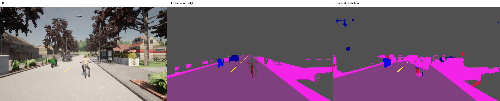
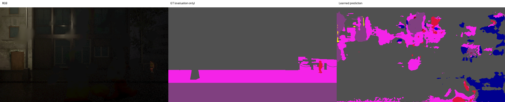

# 首輪模型錯誤分析與下一步

這是已完成實驗的分析，不更改本次 checkpoint、超參數、test 指標或品質門檻。v2 test 已揭露，後續依本分析改模型時只能作 development test，正式驗收需要新 lockbox。

## 實際觀察

| 現象 | 證據 | 意義 |
|---|---|---|
| 夜雨場景失敗 | scene-05 focus mIoU 11.83%，road IoU 1.13% / recall 1.71% | 真實道路大量漏分，不可作導航輸入 |
| 晴天與夜雨差距大 | scene-04=49.04%，scene-05=11.83% | 場景、幾何與天氣同時變化，不能單獨證明天氣是原因；須受控資料補強 |
| 自行車漏判與誤報同時存在 | pooled IoU 6.13%，precision 8.10%，recall 20.21%；夜雨 recall 3.03% | 只提升 recall 或只看正樣本會掩蓋誤報 |
| Bicycle 負樣本誤報 | 700 張 GT-negative views 合計 47,257 個 bicycle 預測像素；100 張 positive views 的 precision 31.73%，但全體僅 8.10% | 必須保留負樣本與全圖指標；100 張正影格高度相關，不是 100 個獨立事件 |
| 行人與汽車誤報多 | pedestrian precision 14.67% / recall 67.41%；car precision 18.87% / recall 63.24% | 已學到部分訊號，類別混淆與背景誤報仍嚴重 |
| 訓練更久不一定更好 | epoch12 validation 27.50%；epoch16 24.05% | 保留 validation-best 有必要；不能用最後 epoch 或 test 挑 checkpoint |
| 完整原尺寸仍有小支持類弱點 | test bicycle 每正樣本只有 101..1000 個語意像素，沒有 >1000 的正樣本 | 原解析度保留訊號仍不等於足夠資料；此為單圖語意像素數，不是 instance 尺寸或 APsmall |
| 速度未達八鏡頭 20Hz | 單圖 network p50 9.07ms；八 view 序列單 bundle 217.09ms | 不能從單圖速度宣稱整套即時；後續需量測批次化與感測器到輸出延遲 |

## 真實模型輸出

每張圖由左到右為 RGB、GT（僅評估）、learned prediction，並非腳本生成辨識結果。兩張均來自固定規則選出的 error gallery；完整 14 張在原 run。

晴天圖可見道路／人行道大致結構，但兩輪車附近分割破碎、背景有交通參與者誤報，不能將這張較可讀的結果當作全面成功。

夜雨圖將暗建築／背景大量錯分成道路、人行道或交通參與者，底部真實道路漏分，與該場景極低的 road recall 一致。

## 可執行的補強順序

1. **先驗證新標註管線。** 既有 v2 保留。新版本五幀、32 sensors pilot，加上 instance segmentation，驗證已知 actor ID／語意／深度一致性、near-plane 與畫面裁切、遮擋與 truncation；人工 QA 後再凍結 visible-instance 門檻。不可把全體 projected 3D boxes 當 visible 2D GT。
2. **增加獨立資料，而非複製影格。** v3 計畫至少 18 個 route groups、30 秒 episode；相同幾何的天氣變體留在同 split，跨 split 保持 route／visibility 區域分離，另留新城鎮／seed 的 lockbox。各 split 內都有多種天氣，才能減少場景與天氣混淆。納入空目標 episode、更多自行車距離／角度／車型、行人、truck／bus、號誌相位、遮擋與臨時障礙物。
3. **受控模型比較。** 以 train/validation 比較 pretrained backbone、train-only rare-class crops、保留負樣本的取樣、class-weight / focal-loss ablation、較廣 photometric augmentation；一次固定一組假設與算力預算，並列 precision / recall / IoU，不能只報加權 loss。這些尚未執行，不能當成本次改善成果。
4. **補失效判定。** 另評 confidence calibration / OOD / abstention 與夜雨失敗率，定義不可用狀態；目前 max-softmax 不是校準的安全機率。車道線 continuity、可見性／遮擋分層與 detector AP 在有正確標註後再作。
5. **容量與端到端量測。** 新資料量先估 decoded RAM / disk / I/O，必要時 streaming / mmap，避免沿用 pilot 全 RAM cache。模型品質足夠後再量八 view batch、包含感測器／renderer 的 latency 與 VRAM，不先把本模型接上控制。

原始證據：test.json、validation.json、history.json、error_catalog.json、engineering_audit.json；資料／偵測契約見專案 configs 與 PHASE3.md。這些補強都仍屬 Phase 3，沒有宣稱已完成完整感知目標。
