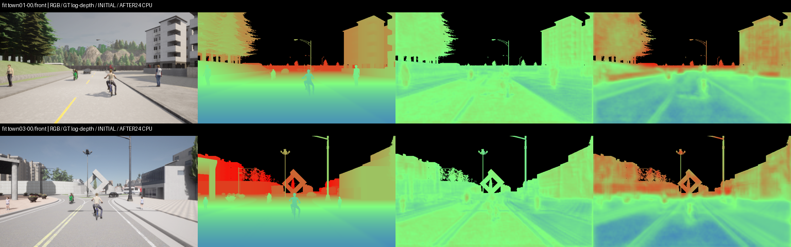
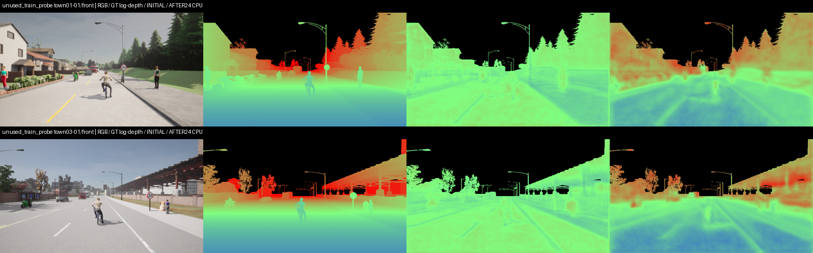

# 深度分支小型可行性測試：CPU通過，尚未正式整合

使用者要求先少量嘗試、只測可不可用。本次只做一次24-update原型，從completed segmentation v6 best初始化；4張fit＋4張其他原train畫面，皆640×360。未開val/development/lockbox，未更動原checkpoint或正在進行的GPU批次，沒有排新完整訓練。

共用原MobileUNet的stride4 decoder特徵，新增6945參數的48→16→1 depth head；RGB為唯一forward輸入，GT packed深度解碼成公尺後只作loss target。原分割CE＋Dice另加.2 normalized-log-depth loss，base LR1e-5/head.003。無augmentation，batch1、CPU FP32、24updates/23.907s。短程fit不是等計算ablation，也不能證明Wall跨城鎮改善。

| 檢查 | 實測 |
|---|---|
| 新分支加入前後原RGB語意輸出 | 全部8張初始CPU logits逐tensor完全一致 |
| depth-only梯度 | head norm.05832、shared encoder.02949，finite且非零 |
| 新head參數 | 6945；原segmentation3589953 |
| 4張fit depth loss | .11706182 → .04277456（初始的36.54%） |
| 4張unused-train depth loss | .13544068 → .04398529 |
| fit AbsRel／RMSE | .80207／20.137m → .36636／13.525m |
| unused-train AbsRel／RMSE | .92671／21.021m → .32700／14.290m |
| 保存／重載原型 | segmentation與depth輸出bitwise identical |
| depth bypass | 同一當前segmentation權重推論完全一致 |
| 正式parent checkpoint | SHA0a3fe...保持原bytes |

3項focused CPU機制測試通過：packed RGB順序／米尺度與sky/ignore/nonfinite mask、空mask與ignored像素無梯度、RGB identity／不消耗主RNG／梯度傳回encoder。新增tests只CPU，不能合稱新增GPU測試。

兩頁四個情境已實看：道路遠近梯度及前景／背景有改善，但仍有紋理印記、道路條紋、邊緣模糊及遠景錯距。**深度圖各欄套同一GT valid mask以便比較；黑色天空不是網路學出的遮罩。** 畫面及數值只支持分支能連接、回傳梯度並短程學習，不支持深度已準確或Wall已改善。

GPU仍由原detector批次使用，本次未跑CUDA/BF16容量、現有隨機幾何增強整合或正式品質驗收。依使用者的小測範圍停在24updates；可保留此方向，待考慮採用後再做一次小型GPU檢查。exact source/config／selected bytes／完整before-after及steps保留，原型權重在本機ignored artifacts/runs/depth-branch-CPU-probe-001/prototype.pt，沒有宣稱已加入Git。

## 對其他類IoU的解讀

另外4張未參與24步更新、但仍屬原模型曾見過的train資料：排除other與Wall後15類mIoU **77.3452%→76.7775%**（-0.5677百分點）；全部16類為77.9207%→77.3974%。pole65.5033%→67.1695%，temporary obstacle78.8752%→79.7571%；pedestrian79.1086%→77.2237%，bicycle73.1573%→71.9956%，road98.9766%→98.9628%。完整逐類數值在initial/final.json。

所以本小測尚無證據支持「其他IoU整體改善」。depth loss下降只證明深度分支能學習；語意權重也同時續訓、沒有不加depth的等更新對照，以上升降不可歸因於depth，也不能當獨立val結果。若決定往下試，先做一次小GPU檢查，再兩組同初始化／同資料／同更新各1輪，最多預先設定各2輪做方向判斷；這是建議，尚未啟動或排程，更不能保證第幾輪會成功。
