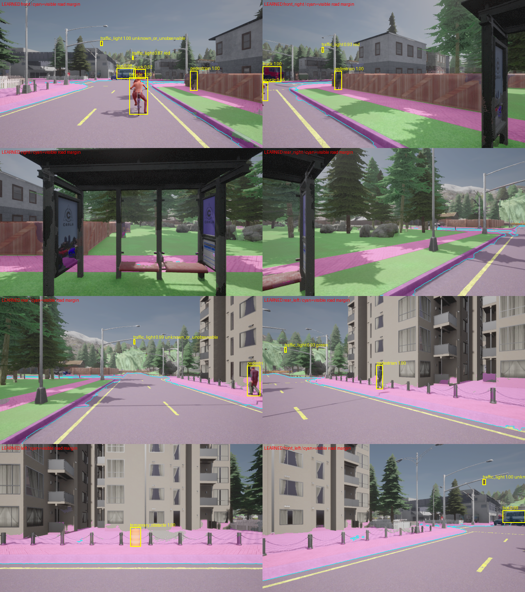

# Phase 3 晴天正式結果

訓練結果已保存，Phase 3 尚未通過全部品質條件。

原始主資料：18 個 30 秒路線群組、2700 bundles、八方向四模態，共 86,400 PNG；完整 CRC/SHA／位姿／語意一致性及 assistant 視覺抽查通過。train Town01/Town03、validation Town04、development Town05、lockbox Town02。

| 模型 | 保留測試驗收 | 逐類結果 |
|---|---|---|
| detection | not_evaluated | [detection model card](detection/MODEL_CARD.md) |
| segmentation | not_evaluated | [segmentation model card](segmentation/MODEL_CARD.md) |
| light_state | not_evaluated | [light_state model card](light_state/MODEL_CARD.md) |

錯例與逐城鎮／逐類 JSON 位於各模型目錄。權重與完整原圖在本機 artifacts/data，Git 保存程式、收據、模型卡與選定錯例。效能收據只涵蓋所列推論範圍，不宣稱 20Hz 閉環。Phase 4 的跨鏡頭融合與三維重建尚未開始。
