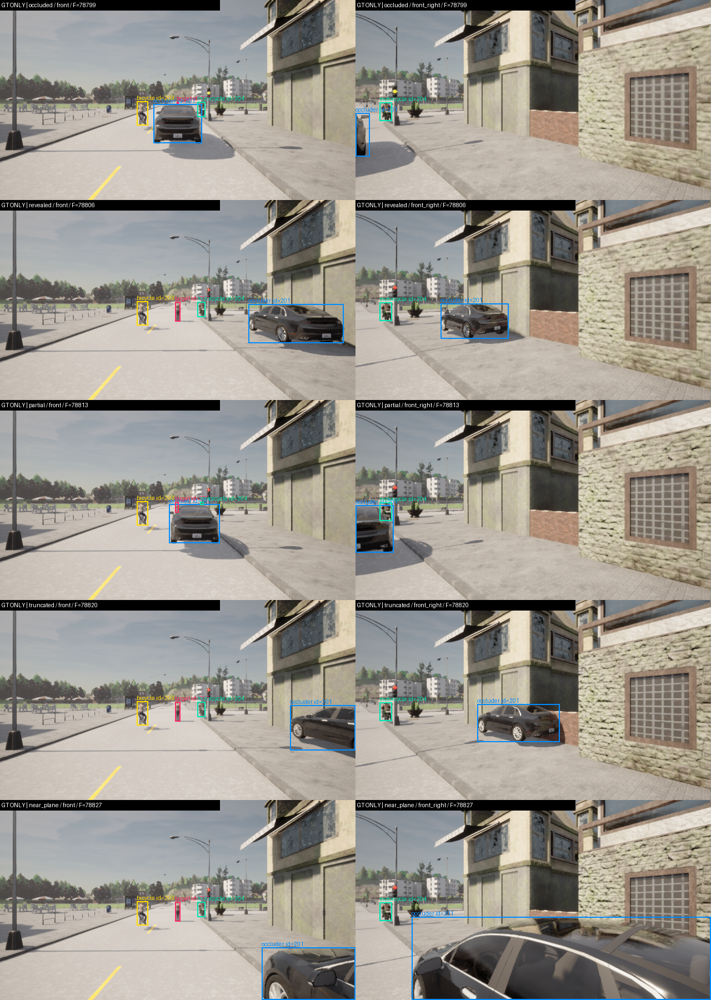
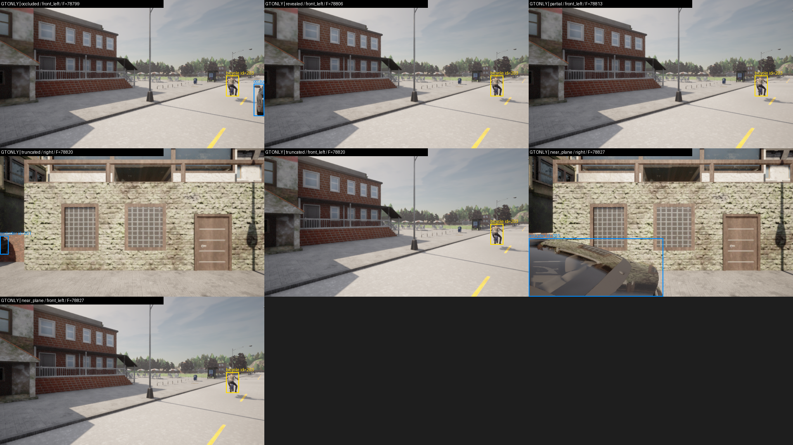
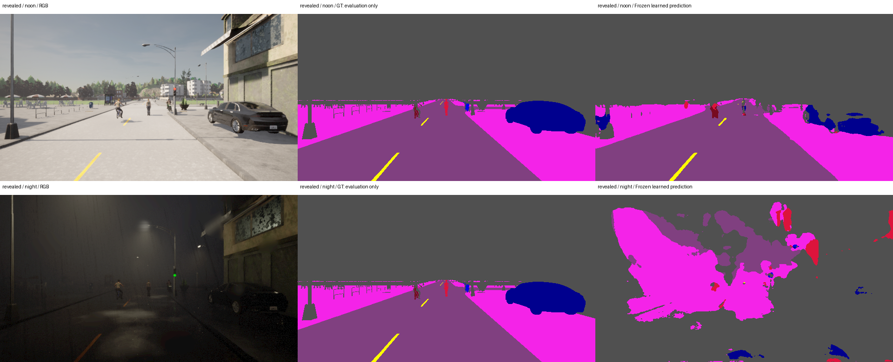

# Phase 3：可見 instance 標註基礎與夜雨診斷

本輪完成標註與資料擷取工程驗證，**整個 Phase 3 仍未完成**。未訓練新偵測器，原模型／原測試成績不變；本輪 controlled fixtures 均 `training_approved=false`。

## 實際執行

| 試驗 | 內容 | 結果 |
|---|---|---|
| Phase 0 回歸 | 同一 patched CARLA 0.9.16、DX12 / Epic，兩次啟動 | 008 / 009 doctor + smoke 通過 |
| 32 sensors 靜態標註 | 八方向 RGB / semantic / depth / instance；遮擋、揭露、部分遮擋、截斷、near-plane | 5 bundles / 160 PNG，timestamp / modality pose error 0 |
| 晴天／夜雨配對 | 相同 actor / camera 幾何與五案，sensor warmup 80 ticks | 各 160 PNG，兩案 capture / disk audit 通過 |
| 動態 32 sensors | BasicAgent 自車、TM 車輛／兩輪車、兩名 scripted walkers | 5 bundles / 160 PNG，0.8s span、自車 0.4196m，ego collision 0 |
| 動態拍攝姿態 | 保存 image.transform 的 owned snapshot，不只由車身位置推算 | 各模態姿態差 0；相對 ego snapshot × rig 平移差最大 0.00001839m，旋轉矩陣元素差 4.22e-7 |
| 軟體與原始影像 | 44 tests；再次 SHA256 驗證四次採集的全部影像 | 全部通過，共 **640 unique raw PNG（其中 160 RGB）** |

動態數值是模擬資料的內部一致性，不是實體相機的微米校正精度。該片段僅 0.8s，部分 NPC 幾乎停住，不能算長時間自然交通或正式 motion coverage。完整 v3 所需 18 個獨立 route groups / 30 秒 episodes 尚未收集。

第一次 sandbox RPC 等待逾時，經 host 端唯讀查詢確認 CARLA 正常後改在允許 loopback 的環境執行；沒有重新安裝、更換圖形 API 或降低既有門檻。該失敗收據也保留。

## 補上的標註規則

依[官方 Tagger.cpp](https://github.com/carla-simulator/carla/blob/0.9.16/Unreal/CarlaUE4/Plugins/Carla/Source/Carla/Game/Tagger.cpp)並經已知角色實測，PNG R 是 raw semantic，instance ID 解碼為 G + 256B；高位截斷有風險，拒絕超過 65535 或重複的目標 ID。不得以此宣稱所有地圖靜態物件都已唯一關聯。

- 自行車與機車的 Rider（raw 13）和車身（19 / 18）確認共用 instance ID。Visible box 合併同一已驗證角色的 rider + body；不能將所有 Rider 當行人或無條件指定成自行車。原 segmentation baseline 把 raw 13 合併 other，其 bicycle IoU 主要是車身語意，不能冒充完整 instance AP。
- 以實際可見 mask 的緊密 xyxy（exclusive max）作 visible box；amodal 3D 投影另存，不以全體投影 box 當正樣本。沒有可見 mask，就沒有正樣本，也不把不可見物件的整個投影區域設成 ignore。
- 深度實測較符合 camera-forward / axial 定義。控制車輛的 expanded OBB 支持率 axial=99.657%、range=76.812%；revealed/front 個例為 99.933% vs 2.402%。後續深度幾何不能把 packed depth 直接當任意方向的歐氏距離。
- 遮擋車移開後，front 行人可見像素由 14 → 212；部分遮擋為 48。這是干預證據；mask/bbox fill 不是一般場景的真實 occlusion fraction。
- Policy v1.1：至少 32 可見像素、bbox 邊長 4px；兩輪車至少 8 個 body pixels；near-plane 物件 ignore；有足夠支持的畫面截斷物件保留並另標記。只露騎士、極小／語意或深度不一致、未解析前景均明確 ignore。
- 未解析號誌、標誌、動態物件等保留 ignore masks / regions；不能直接當背景負樣本。已實作並測試 proposal ignore 契約，positive matches 優先，background 才可設 -1。**尚未接上真正 detector 的 RPN / ROI 兩處 sampler**，不可宣稱 ignore-aware detector 已完成。

視覺檢查發現 v1 的固定像素投影界線會拒絕兩張真實邊緣車輛；v1.1 改用與深度一致的 0.15m expanded OBB 投影支持範圍，觀測 visible box 與原始 amodal box 都不改。保留 v1 與 audit-v2；新增 v1.1 / audit-v3，沒有覆寫歷史或修改模型品質門檻。

原靜態 pilot 的 160 個 actor-view 配對，在 v1.1 得到 **34 個 eligible positive views、4 個 ignore、122 個不可見**。這不是 34 個獨立物件或場景。`visible_instances_v1_1` 仍標記非訓練資料。

## 真實 GT 視覺 QA

以下框線都是 simulator GT 可見區域，**不是 AI 偵測結果**。Assistant 已檢視含已知角色的 17 張圖／38 個 visible object views；其他 23 張沒有已知 visible target 的圖由幾何與資料稽核檢查，未宣稱全由人工作過檢視。這不是人類認證，reviewer 與圖 SHA 在 visual_review.json。

動態首尾 front 影像另見 moving/qa-motion；可見框隨實際角色與相機移動，GT world transforms 只保存在 labels。

## 凍結模型的晴天／夜雨診斷

只用原 epoch12 checkpoint，SHA256=f06e4b110ea767d2c4b910d2cbfa8f9ea3ef96fa807c950bd2afd5f54947a1d4，**optimizer updates=0**，不選模型、不重跑原 test。

| 配對條件 | 40 views pooled focus mIoU | 平均 RGB（0–255） |
|---|---:|---:|
| ClearNoon | 47.56% | 138.67 |
| HardRainNight | 2.37% | 29.38 |

Actor / camera pose 差 0，raw semantic target 差異約 0.0982%，並非完全相同 mask。這是原 train 曾出現的 Town01 road-24、同四個固定角色及高度相關的五案，不能作新的泛化成績或信賴區間；完整 weather preset 同時改變多個因素，不能單獨歸因於雨。預設相機曝光屬性在這兩次靜態採集中未另外序列化，80 ticks warmup 相同；後續動態 collector 已補存全部 32 個 sensor 的實際 attributes。

夜雨模型幾乎失去道路訊號，並把暗背景錯分成道路／人行道／人，應優先補低光／雨霧資料與失效判定。新診斷不能替換原 test focus mIoU 26.22%，也沒有新模型改善成果。

## 下一個單一任務

準備並凍結 v3 的跨城鎮 route / split 與長 episode 收集：先做 Town03 / Town04 / Town05 / Town02 的地圖與 asset 可行性 probe，再按已提出的 whole-town allocation／route groups 建計畫；Opt 與非 Opt 不當成不同城鎮。補 truck / bus / traffic-light state / temporary-obstacle 的 blueprint taxonomy 與 GT QA，不能把所有 static/dynamic tag 都當臨時障礙物。完整資料收集前凍結每類獨立正例 episode 配額、negative episodes、可見性規則與 lockbox，之後再訓練並測試真正 ignore-aware detector。

原始資料留在 data/instance-probe-v1-001、data/instance-weather-{noon,night}-v1-001、data/motion-instance-probe-v1-001。原始模型對照與每 view metrics 在 artifacts/runs/illumination-diagnostic-v1-001；這裡保存收據、指紋與可檢視圖片。
