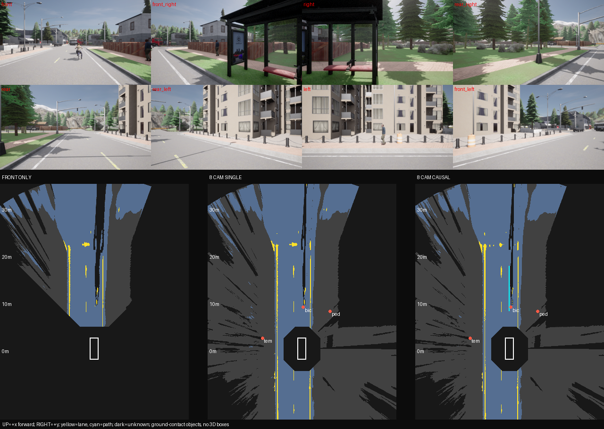
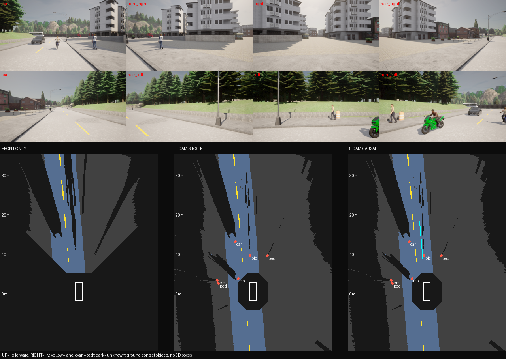
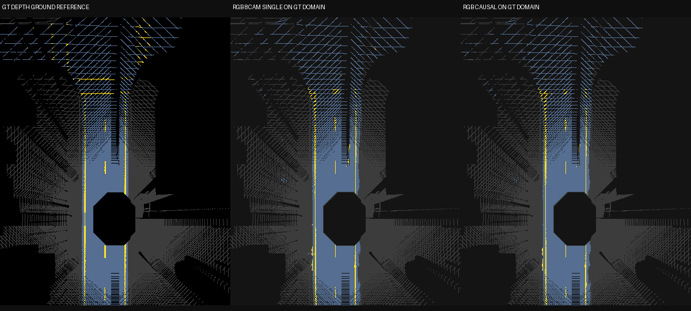

# Phase 4：八鏡頭道路 BEV 首版實測

2026-10-20，依使用者「做Phase 4，規劃完成後立刻開始」完成規劃、程式、兩次 CUDA 離線 replay、獨立 GT 評估及實際圖像檢查。**幾何融合原型已完成；Phase 4 新完整路線正式驗收尚未完成。** 本輪沒有新增訓練、啟動模擬器或發車，不納入深度分支，不補訓 Wall。

## 目前能做什麼

八 RGB 加固定內外參，經原 v6 分割／偵測與號誌模型，產生公尺座標道路與標線 BEV、觀測／遮擋遮罩、帶來源的跨鏡頭地面接觸點合併、RGB 視覺 SE(2) 配準及最多三幀的因果時序融合。可見標線足夠時輸出車道中央候選軌跡；證據不足、標定切換或序列中斷時拒絕／重設。地面 z=0 與單側車道寬度是明確固定先驗。

候選軌跡代表幾何車道中央，沒有障礙通行與避讓規劃。地面接觸點不是 3D box、車輛尺寸或速度；交通燈維持 2D／phase，不投影成地面物件。輸出不能直接當控制命令。

## 實際資料與隔離

在新推論前固定每 scene 的 20／60／100 起點、每窗 8 組，保留所有 33 候選及排除原因；30 窗符合可見 raw Wall／標線／平坦性抽樣條件，依固定順序取兩個原 train、兩個原 validation scene。最終 town01-00／01 與 town04-00／01，均 start20，共 **32 bundles／256 RGB**。每段只有 1.4 秒，相鄰影像高度相關，模型已見原 train，validation 也曾用於模型選擇，不能稱為獨立泛化驗證。

近走廊 raw Wall 抽樣為零只描述可見標籤，並非整條路線無牆認證。實看仍有低隔牆、Fence、護欄與建築；這輪只用舊資料開發幾何，沒有在這些片段發車。後續仍需事前確認整條無近牆的晴天路線。

推論 staging 只有 292 個 RGB／manifest／calibration 檔案。GT semantic、depth、instance、actor、ego pose 只由獨立選景／評估程式讀取；推論不讀 depth 或 GT pose，motion 完全來自 RGB。兩種實際 CPU CLI 污染測試（多放 GT 檔、序列混入 GT pose）均在模型建立與 output 建立前拒絕。

`selection/` 保留全部候選、乾淨序列清單、RGB inventory 與小型輸入中介資料。原 RGB／資料全集／權重不在 Git；雜湊及本機路徑留在收據，不能只靠本資料夾在新機重跑模型。

## 固定 32 組的結果

GT 以保存的 depth 與 semantic 獨立 forward raster，只評可見、近固定平面的地面；沒有補 GT 空洞。對 GT road 的 unknown 預測計 FN，不用預測遮罩隱藏錯誤。GT 深度不進模型。線條採 0.1m 格點上 5×5 橢圓距離容忍（最遠約 0.224m，在宣告 0.25m 內），不是精確連續圓盤。

| 相同周遭 GT 可見地面域 | 道路 IoU | 標線 F1@0.25m | GT 地面覆蓋 |
|---|---:|---:|---:|
| 單前鏡頭 | 46.63% | 55.35% | 34.35% |
| 八鏡頭單幀 | 95.07% | 89.97% | 97.17% |
| 八鏡頭時序 | 95.20% | 90.27% | 97.17% |

單前鏡頭在周遭域的低分包含後方／側面沒有視野的影響。另在**共同前方 GT 可見域**評道路 IoU：94.16%／95.15%／95.21%，線 F1：88.67%／89.01%／89.47%。同視野品質增益較小；八鏡頭主要補覆蓋，時序增益有限。

| Scene | 八鏡頭單幀道路 IoU | 八鏡頭時序道路 IoU |
|---|---:|---:|
| town01-00 | 96.06% | 96.17% |
| town01-01 | 95.69% | 95.82% |
| town04-00 | 93.20% | 93.46% |
| town04-01 | 95.57% | 95.59% |

RGB motion **28/28** 段可配準，對 GT 平均平移誤差 **1.88cm**、yaw **0.018°**。這些極短、已知路段的結果不能代表長程漂移或轉彎泛化。

| 候選軌跡來源 | 組數 | 逐幀橫向 RMSE 的平均 |
|---|---:|---:|
| 雙側預測標線 | 16 | 1.14cm |
| 單側預測標線＋固定 3.5m 寬度先驗 | 16 | 30.63cm |
| 合計 | 32／32 可與 GT 比較 | 15.89cm |

最大逐幀 RMSE 為 34.81cm；各幀 p95 橫向絕對誤差的最大值為 37.85cm。單側先驗不等於量測寬度，明顯較差；本輪沒有用 GT 寬度修正先驗來美化數值。曲線／虛線等合成測試通過不表示已做足夠真實長彎路驗收。

地面接觸點位置以 2m、同類、one-to-one 配對：**TP88／FP58／FN72，P60.27%／R55.00%**，配對平均 XY 誤差 37.46cm。移除 64 筆重複觀測；57 個有 GT 支持的合併群未混入不同 actor，此結論只限可支持群，不能說全部合併正確。自行車／機車／行人誤分類、漏檢與錯誤接觸點仍在，未達可靠 3D 重建。

每組八鏡頭計算總時間 **p50=1097.78ms，p95=1263.63ms**（先逐組加總解碼＋網路及幾何／motion／path，再取分位數）。網路部分 p50=502.43ms，融合部分 p50=600.77ms；總時間分位數不是兩個分位數直接相加。尚排除載入、標定預算、寫圖／NPZ、模擬器、感測與控制，未達 20Hz 或即時閉環。

## 實際檢查及保留的不足

**193 項 unittest：0 failures、0 skipped，10.711 秒**，包含 CPU 與 GPU 項目；新幾何／評估 focused tests 共 30 項。覆蓋相機軸與 half-pixel、八方向含平移 round-trip、地平線／後方／距離拒絕、SE(2) 方向與 outlier、遮擋與 history reset、同鏡頭／跨類／鏈式去重、直彎標線／虛線缺口／無線拒絕、unknown FN 及 GT domain 獨立性。

已實看 **12 張 contact pages（全部 32 組 prediction 與 GT）＋7 個完整 prediction 代表／高誤差案例＋4 個固定中間 GT 圖**。道路與黃線大致對齊，八視角補側後方；近自車盲區和遮擋保留 unknown。遠處假線／道路邊界破碎、物件誤分類與漏檢仍可見，部分幾何候選線靠近物件，不能解讀為可安全通行。







圖例、全部 contact pages 與實看收據見 `visual_QA/`。原始 run／report／catalog 的 pending 字樣代表產生檔案當時的狀態，**沒有事後改寫原 bytes**；後續實看完成以 `visual_QA/visual_review.json` 與 `decision.json` 為準。

檔案核對已從全部 32 份保存的 BEV／GT reference 重算三模式所有評分及逐 scene，全部一致，確認 38 個凍結來源、三模型 SHA、序列／來源與 QA 圖雜湊。此為檔案一致性檢查，不能取代品質驗收。

## 修正與版本追溯

第一次選例因標籤 image 欄位為 dict，在任何新推論前失敗；修正後產生新 selection002，原 failure 保留。第一版 GPU 001 只有 2/32 雙標線可用；v1.1 才加入明確單側寬度先驗與不超過 6m 的虛線缺口，無線仍拒絕。兩版 32 份 BEV arrays 和 detections JSON 全部 exact，變更只在 path，第二次不是新的獨立樣本。

初版 GT 軌跡比較因 road_id 切段而比較不到，後改為連接連續車道，並新增共同前方域比較。舊 report／evaluator 留在 `history/`，不能拿舊 n=0 當路徑誤差零。最終權威 report 為 `evaluation/report.json`。另一次中間 evaluation002 留在本機，與最終版分開。單元測試曾遇外部 temp 權限問題，改用純 mock 測 GT 讀取，沒有藉此跳過或改鬆模型品質。

兩版執行時的凍結來源與 config 在 `inference-v1.1-source.tar.gz`／`paired-only-v1-source.tar.gz`，驗證工具與 tests 在 `validation-and-tools-source.tar.gz`；每個 tar 的 member bytes 均另列 SHA256。`copy_receipt.json` 對應原檔與歸檔檔，`manifest.json` 涵蓋歸檔檔案（不含它本身），evidence 在 Git 設定 -text 保留原 bytes。

固定模型 SHA：segmentation `0a3fe3f66fb93be373f2e82218632a4f8cc277bf6067f48bb4683a71f1b2af30`；detector `ba6d2f4269a7f3f95e4b92d7daff1f330f4203a4619e1f5902c752aa371f7155`；phase `f9836ef6474d74b607124cbb4887492105b3949f23d3c9065741d86c160b451e`。依賴版本與新增 OpenCV wheel 雜湊見 `dependencies.json`。大型原RGB／GT、權重、逐鏡頭觀測及浮點 BEV NPZ 留本機 ignored，完整輸出雜湊在 `checks/phase4-artifact-integrity-001.json`；本歸檔保留 32 份 GT reference、逐幀 JSON 與圖，沒有假稱 Git 已保存完整資料／所有 NPZ。

## 重現命令

需本機既有 audited data、三模型與 requirements-phase4 環境。每個輸出用全新目錄；下面示例的 new-* 名稱已與本次原始證據分開。選例必須在新推論前執行，inference 只吃 staging。

```powershell
.venv/Scripts/python.exe scripts/select_phase4_pilot.py --root data/sunny-cross-town-v3-007 --output artifacts/runs/new-phase4-selection
.venv/Scripts/python.exe scripts/prepare_phase4_inputs.py --selection artifacts/runs/new-phase4-selection
.venv/Scripts/python.exe scripts/run_phase4_pilot.py --root artifacts/runs/new-phase4-selection/rgb_only --input-list artifacts/runs/new-phase4-selection/sequence_inputs.json --inventory artifacts/runs/new-phase4-selection/rgb_only_inventory.json --config configs/phase4_bev_v1.json --output artifacts/runs/new-phase4-run --device cuda
.venv/Scripts/python.exe scripts/evaluate_phase4_pilot.py --run artifacts/runs/new-phase4-run --root data/sunny-cross-town-v3-007 --selection artifacts/runs/new-phase4-selection --output artifacts/runs/new-phase4-evaluation
.venv/Scripts/python.exe scripts/make_phase4_review.py --run artifacts/runs/new-phase4-run --evaluation artifacts/runs/new-phase4-evaluation --output artifacts/runs/new-phase4-QA
.venv/Scripts/python.exe -m unittest discover -s tests -v
```

檔案重算不用 GPU：`scripts/verify_phase4_artifacts.py --run ... --evaluation ... --review ... --boundary ... --output artifacts/reports/new-integrity.json`。圖像檢查必須另實看，產圖不等於 review 完成。archive 工具專門固定本次 ID，重現新實驗時不能誤歸檔為本次。

## 下一個 Phase 4 里程碑

事前固定**全新、晴天、平坦、完整無近牆、標線清楚**的直線／彎道路線及數值門檻，先採集與離線 replay；增加較長缺口、遮擋、低紋理與配準失敗連續長度的驗證。獨立報路徑兩種來源、逐路段精度及可用率，不能用這些已知短片的分數事後宣告正式 pass。

接著處理 ~1.1 秒延遲及 ground-contact 物件可靠度，保留所有來源／不可信標記，不為此重啟 Wall 或 depth 訓練。Phase 8／9 的控制器、通行檢查、失效煞停與閉環另行實作；先展示循線時也要限定預先清空交通且完整檢查過的路線。目前沒有待跑背景工作。
