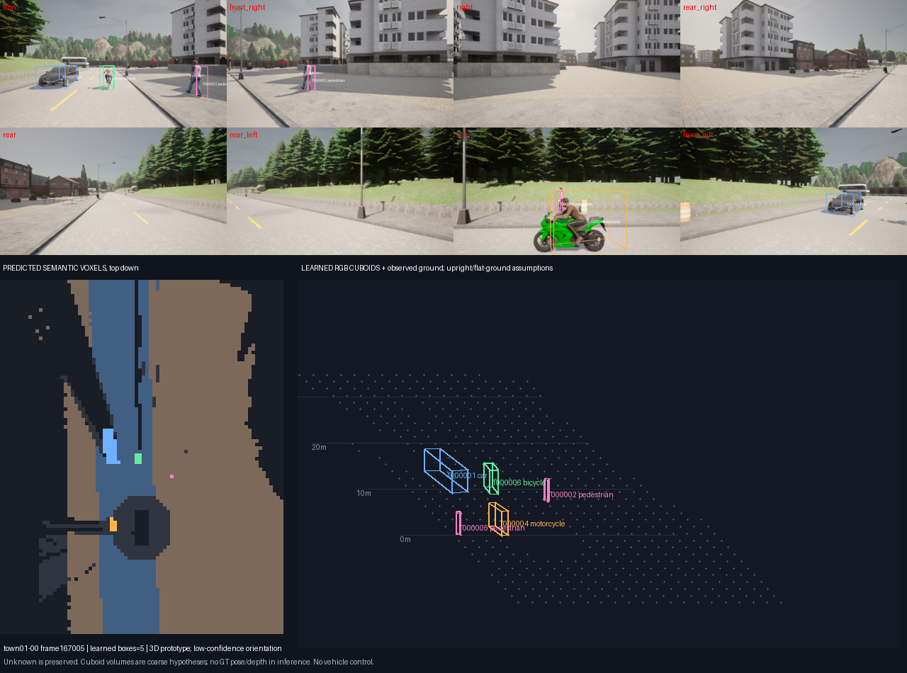
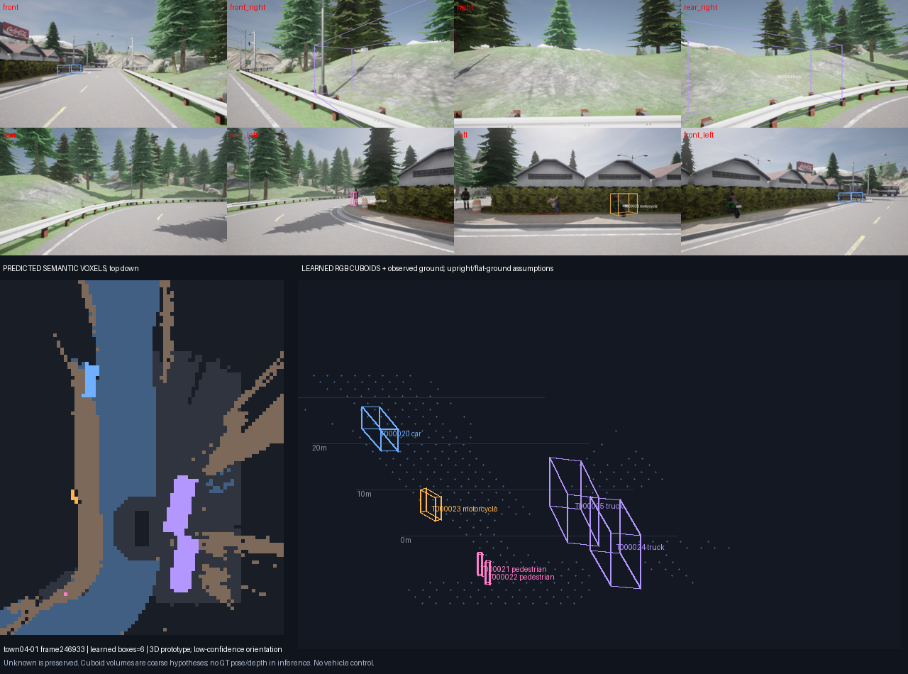
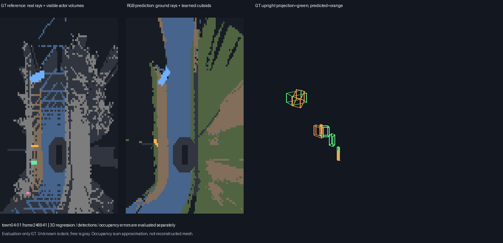

# Phase 5：三維物件與 World Model 首版

2026-10-20 已依使用者「很好，繼續phase5」先規劃後實作，完成一次固定 12 輪的小型 3D 模型訓練、兩次真 CUDA 八鏡頭 WorldFrame replay、獨立 GT 評估、污染拒絕檢查、視覺檢查與來源核對。**首版工程基準已完成，Phase 5 品質尚未驗收通過。** Phase4 的新完整路線與效能限制繼續保留；本輪未發車、不啟動 CARLA、不加訓 Wall、不納入深度輔助分支，沒有開 development／lockbox。

## 已交付

- 真正從 RGB 學習中心、尺寸與 yaw 的 94,424 參數 crop CNN，接在既有自訓 detector 後；不是把 GT 座標或固定車型畫成 AI 成果。中心使用 bbox vertices平均，尺寸為2×extent，訓練target保留bbox local rotation。
- 八鏡頭 ego 座標 cuboid 融合，保留來源，完整群距≤1.5m，不跨類／同鏡頭合併，朝向作向量平均。
- 因果基本 ID：RGB SE(2) 補償後，同類最近鄰一對一配對，斷流／回時／標定／場景／配準失敗重設；漏檢的 held tracks 不填當前occupancy。尚無可靠速度或未來預測。
- 0.5m 三維 semantic occupancy：可見地面射線＋預測 cuboid 體積；unknown保留、物件優先於free。這是粗幾何近似，非學習式 occupancy network／fine mesh；沒有量測路緣高度。
- 每幀 `world.json`／`occupancy.npz` 與8視角投影、BEV、等角3D圖，另有獨立GT圖。`src/senior_ai/world_schema.py`供Phase6讀取契約驗證。

## 學習資料與方法的界線

原主007通過人工視覺核准，資料／RGB／GT metadata inventory對上既有parent SHA。只用原train 8 scenes與validation 3個Town04 scenes，每scene固定stride8全程取樣，最終659 train／232 validation crops，六類都有train支持。GT只產生targets或獨立評分，不進模型features。訓練12epochs／132updates，無額外輪數與超參數搜尋；梯度非零、權重更新與checkpoint reload exact。

本輪3D head訓練很小、資料相關性高，不能以完成訓練等同學好3D。232個GT crop/class條件驗證，中心平均1.204→0.931m、IoU3D .195→.231，但yaw **53.03→72.05°退步**，行人位置也退步。相同模擬資產重複，使原類別L/W先驗已是0誤差；網路沒有證明形狀／尺寸泛化。詳 [模型卡](MODEL_CARD.md) 與 `training/conditional_validation.json`，六類與三個scene分開列出。

固定模型 SHA、執行來源與相機座標、dtype、crop規則、config皆封存；新增模型best.pt SHA為 `1ad8ccbf8e5409b476219b8ecaf0924922a756c19b845043b9cbeae99fd32f6f`。沒有安裝新環境依賴；requirements-phase5沿用Phase4。大型資料、RGB裁圖package與權重留本機ignored，Git只保留target紀錄、雜湊與結果，不是完整可攜模型／資料包。

## 實際 detector → 3D 的結果

沿用Phase4事前固定32組、4個各1.4秒的序列。2D detections／分割與RGB motion直接使用已核對SHA的RGB-only Phase4輸出，不再重跑或改訓Phase3模型。3D head真CUDA前向，八鏡頭融合後以同類、2m XY及one-to-one配對；IoU3D另用.25門檻。所有GT可見positive actor bbox中心≤25m都計入，即使head無法投影也計FN；不靠預測遮罩縮小GTdomain。

| 嚴格物件評分範圍／方法 | TP／FP／FN @2m | 定位Precision／Recall | IoU3D≥.25 Precision／Recall |
|---|---:|---:|---:|
| 原train片段16組／先驗 | 58／25／19 | 69.88%／75.32% | 57.83%／62.34% |
| 原train片段16組／學習 | 74／14／3 | 84.09%／96.10% | 51.14%／58.44% |
| **validation片段16組／先驗** | 27／25／32 | 51.92%／45.76% | 25.00%／22.03% |
| **validation片段16組／學習** | 33／21／26 | **61.11%／55.93%** | **27.78%／25.42%** |
| 全32組混合／學習 | 107／35／29 | 75.35%／78.68% | 42.25%／44.12% |

定位涵蓋率有改善，但完整方框仍差，混合分數受train片段影響，不能當未知路線成績。validation上的配對中心平均0.730m／yaw50.51°只描述已成功2m配對的33例；漏檢與FP另由P/R保留。

為避免不同成功配對集合混淆，另比較**兩方法共同配對的25個validation actor-frame**：中心3D **先驗.649m→學習.831m**、yaw **29.70→49.11°**、IoU3D **.248→.211**。這個受條件選擇的子集合顯示退步，不能只報漂亮整體平均。完整同GT比較見 `checks/phase5-supplement-v1-001.json`。

原始主報告採嚴格3D正例域，未略過2D ignore region。補充依既有2D政策審計：只有全部來源都在ignore、且沒有2D／3D已知positive支持才略過；train與validation分別6／5個fused proposals，兩方法一致。validation定位P變成先驗57.45%／學習67.35%，Recall不變。主報告與原始FP保留，此補充不是事後降低品質門檻。背景車輛／資產不一定有完整actor GT；未配對並不一律表示場景中不存在該物件。

32組學習結果中移除44筆跨鏡頭重複觀測，39個有GT支持合併群沒有混入不同actor；僅限可支持群。六類的TP/FP/FN與IoU分開保留；本32組沒有公車positive actor，卡車actor P/R無正例支持，不能宣稱這兩類驗收成功。語意depth可能仍看見背景卡車表面，因此occupancy的truck表面support不等於有truck actor體積GT。

## 追蹤、佔據與效能

基本ID在86個連續成功配對的actor transitions中有 **11次切換**；5次間隔後重配對未改ID。ID切換集中原Town01近鄰／重複行人假設，Town04仍有漏檢與FP，所以不能憑某些短片零切換宣稱穩定追蹤。保持ID工程與Phase7完整追蹤仍需改進。

GT occupancy由真depth/semantic稀疏射線／表面，加25m內可見positive actor完整捕獲3D旋轉box體積建立，不是全場完整mesh。近地面±.2m的road／sidewalk／terrain才snap至z0。unknown預測在GT已知域仍計FN，free格不佔據格也分開評。

| 語意格點 | IoU |
|---|---:|
| Road | 89.67% |
| Sidewalk | 79.71% |
| Car | 65.22% |
| Pedestrian | **4.77%** |
| Bicycle | 51.12% |
| Motorcycle | **18.85%** |
| Truck（含背景表面） | 7.38% |
| Bus | 無GT支持，不評 |
| Free | 13.81% |

已知GT域預測覆蓋僅 **19.31%**；4873個GT occupied voxels被判free，佔GT occupied **4.23%**；terrain與未建模靜態表面IoU為0。這些結果不構成可靠通行空間，不用整體道路分數掩蓋行人／兩輪車／free問題。0.5m中心取樣對窄行人有aliasing，未將其拿掉美化指標。

新增階段3D／fusion／tracking計算p50 **34.42ms**、occupancy **72.70ms**。逐幀加上原Phase4實測成本後，stage sum p50 **1213.68ms**／p95 **1366.89ms**；此為replay各階段量測加總，排除載入、檔案輸出、感測與控制，不是實際即時閉環或FPS達標。

## 實看與幾何修正

實看16張contact頁，涵蓋全部32組prediction／GT，另6個代表／高FP／高yaw案例的完整prediction與完整GT圖，共12張。原始圖與逐圖SHA、實看收據在 `visual_QA/`。可看到車／自行車位置有用，但行人橫移、rider混類、兩輪車漏檢、右側岩石／樹木被誤判成大卡車的錯例均保留。







首次run001暴露射線穿過地面格上方空氣後把整個含地面格判free的歧義。修正後，預測與GT評估都禁止carve地面／地下slab，並排除各射線endpoint voxel；保留原run001 report／source，不覆寫。run002的32組所有3D objects、prior objects與tracking **對run001 exact**，只有occupancy策略／GT域修正，模型完全未加訓。較高road IoU部分來自修正GT/free定義，不能宣稱是模型學習提升。

第一次資料準備001拒絕未被parent metadata inventory綁定的indexes/train檔，沒有開始訓練；改用已核准canonical training/train.jsonl去重每frame後產生002，原failure保留。幾何測試也抓到x邊界半開區間問題，在第一次WorldFrame前修正。

## 驗證、契約與重現

**223項完整回歸測試全部通過，0fail／0skip，14.656秒**，包含CPU／GPU項目，不是223項都作GPU計算。座標／corners／IoU3D／yaw wrap、去重／漏幀／回時／scene reset、GT與unsafe path拒絕、unknown/free、已知positive覆蓋ignore的測試見 `checks/`。最後CPU檔案核對重新驗證 **3572個原RGB／GT檔**，重算232條件驗證、32份三維物件計分及occupancy／逐scene混淆矩陣、重播tracker全ID，並確認模型與來源hash。這是可追溯工程證據，不是品質pass。

WorldFrame v1：current ego、x前/y右/z上、公尺、完整LWH與yaw弧度，`objects`只含當幀量測，`tracking.held_unobserved_tracks`不進occupancy。`orientation_reliable`只是heading vector有效性啟發式，不是校準的正確率。`occupancy.npz:semantic`採row:-x／column:+y／layer:+z，255unknown、0free、1road、2sidewalk、3car、4pedestrian、5bicycle、6motorcycle、7truck、8bus、9terrain。網格x[-15,35)、y[-20,20)、z[-.5,4.5)，resolution0.5m；各frame帶檔案SHA。2D號誌與Phase4道路path仍沿用上游；path不是障礙避讓結果，尚無速度／預測。

在repo根目錄、本機既有audited資料與模型環境下，輸出都必須使用全新目錄：

```powershell
.venv/Scripts/python.exe scripts/prepare_phase5_crops.py --root data/sunny-cross-town-v3-007 --config configs/phase5_world_v1.json --output artifacts/runs/new-phase5-crops
.venv/Scripts/python.exe scripts/train_phase5_cuboids.py --dataset artifacts/runs/new-phase5-crops --config configs/phase5_world_v1.json --output artifacts/runs/new-phase5-model
.venv/Scripts/python.exe scripts/run_phase5_world.py --root artifacts/runs/phase4-pilot-selection-002/rgb_only --phase4 artifacts/runs/phase4-bev-pilot-002 --phase4-integrity artifacts/reports/phase4-artifact-integrity-001.json --input-list artifacts/runs/phase4-pilot-selection-002/sequence_inputs.json --inventory artifacts/runs/phase4-pilot-selection-002/rgb_only_inventory.json --checkpoint artifacts/runs/new-phase5-model/best.pt --config configs/phase5_world_v1.json --output artifacts/runs/new-phase5-world --device cuda
.venv/Scripts/python.exe scripts/evaluate_phase5_world.py --root data/sunny-cross-town-v3-007 --run artifacts/runs/new-phase5-world --output artifacts/runs/new-phase5-evaluation
.venv/Scripts/python.exe scripts/make_phase5_review.py --run artifacts/runs/new-phase5-world --evaluation artifacts/runs/new-phase5-evaluation --output artifacts/runs/new-phase5-QA
.venv/Scripts/python.exe -m unittest discover -s tests -v
```

推論不帶GT root，僅RGB staging／校準、hash-bound Phase4預測與checkpoint。兩種實際CPU污染CLI均在嘗試開啟刻意不存在的checkpoint前拒絕，證明不是靠GPU或模型跑完才發現。archive的tar附member SHA、copy_receipt與manifest保留raw bytes；完整三維occupancy NPZ／GT reference／逐幀JSON／圖在本目錄，原始RGB、訓練裁圖NPZ、權重僅本機ignored。

下一步針對**方向對稱、行人幾何、跨鏡頭重複與ID競爭、稀疏free-space證據**設計事前固定的新資料／門檻；不靠持續加輪讓同一組驗證分數變漂亮。Phase6可消費此WorldFrame研究輸出，但必須顯示低可信及unknown，不能包裝成即時可靠重建。精細geometry與閉環仍未完成。
