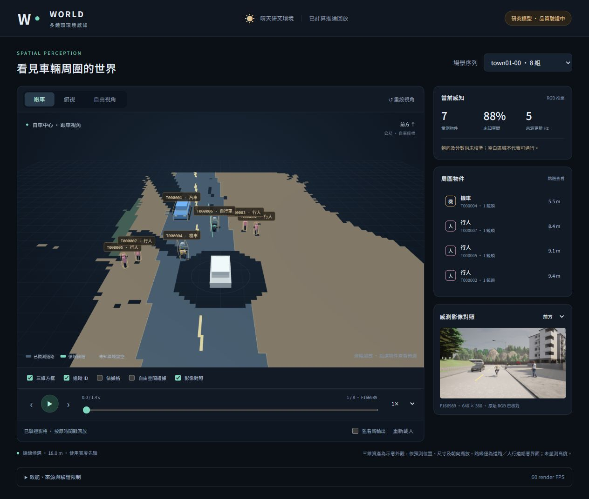
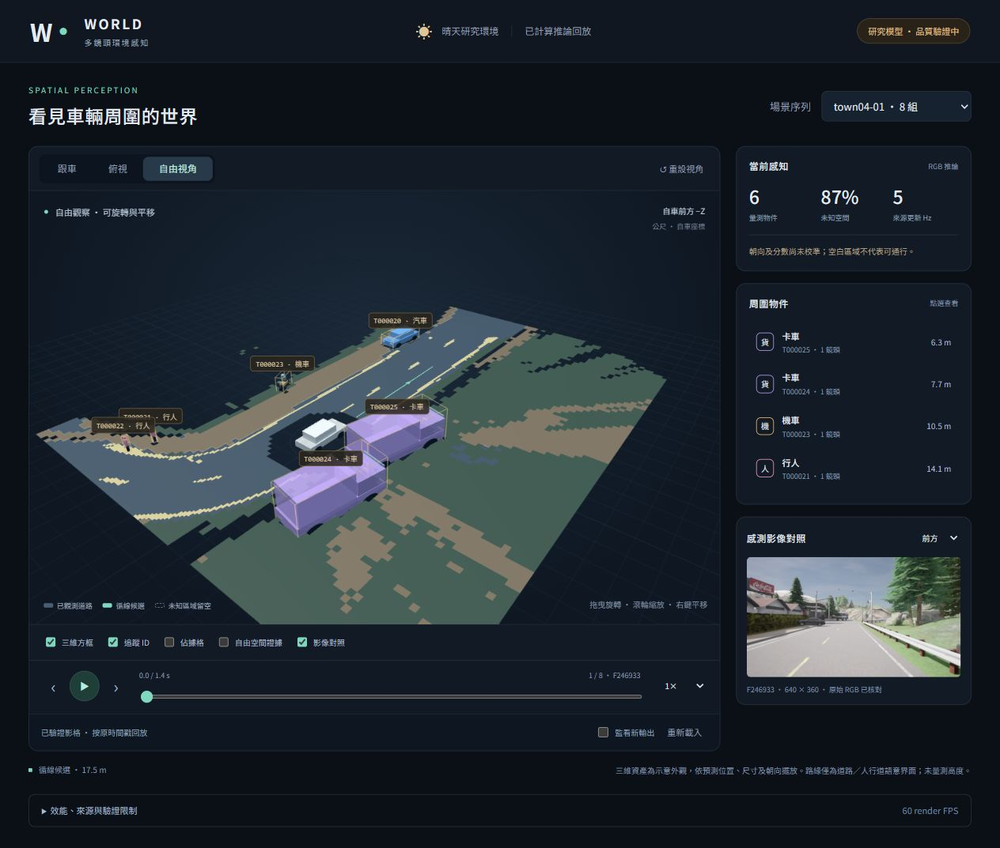

# Phase5／6 聯合工程驗證與互動3D研究版

2026-10-20，依使用者要求一併驗證Phase5與建置Phase6。**工程串接可用；模型品質及模擬器連續即時驗收未通過。** 未加訓、未改權重、未重啟Wall／depth、未開dev／lockbox，也未發車。舊Phase3／4／5證據不改。

本機執行根目錄的 `Start-WorldViewer.ps1`，在瀏覽器開啟 `http://127.0.0.1:8766/`。交付前已停止測試服務，沒有留下監看器；重新執行launcher即可檢視。完整命令、依賴與完成矩陣見[PHASE6.md](../../../PHASE6.md)。

## 驗證結果

| 核對 | 實際結果 |
|---|---|
| Phase5資料與新CUDA驗證 | 891 RGB crop逐byte對原始來源一致；891個GT target用原world vertices與capture transform獨立核對；232 CUDA輸出exact。權重SHA `1ad8ccbf8e5409b476219b8ecaf0924922a756c19b845043b9cbeae99fd32f6f` 不變 |
| 顯示出口 | bundle002：32影格、4場景、147物件、256張RGB、320檔全部hash；32組objects／occupancy binary／道路線／語意界面／path與Phase5／4來源一致 |
| 空間契約 | ego(x,y,z)→Three(y,z,-x)，yawY=-yaw，尺寸(W,H,L)。真正Three.BoxGeometry角點與Python誤差<1e-6；32份真browser DOM診斷的ID／位置／尺寸／yaw／數量／來源SHA逐項通過 |
| Python | 235項0fail／0skip，15.329秒，包含12項新viewer契約／stream／Windows替換重試測試 |
| JavaScript | 20項通過，含座標、corner、grid半格、timestamp gaps、非法資料與SHA污染拒絕；另真bundle client核對全部32影格／256RGB，cache限16 |
| HTTP | 22項實際loopback檢查，檔案白名單、SHA、CSP、GET/HEAD、拒絕POST、workspace／GT／traversal拒絕、waiting/ready/stale/invalid、來源遭改拒絕，測試服務自行停止 |
| Browser | 30筆操作收據；三視角／drag／zoom／reset／raycast／列表、四場景32逐幀、四場景.5×完整播放、1×／2×／seek、八RGB、layers、390px無橫向overflow、GT污染／stale／恢復、真正WEBGL_lose_context／reload |
| 顯示效能 | 70次CPU建立＋繪圖提交p50 32.2ms／p95 41.1ms，verified fetch p95 16.8ms；161段約1秒render採樣median60FPS；renderer geometry峰81、末42，textures0。達事前顯示門檻p95<200ms／median≥30FPS |

效能只代表本機IAB與已知短序列，CPU套用不含GPU present，不是多小時壓力測試。32組每段1.4秒、原timestamp5Hz；Phase5含上游stage加總p50 **1213.68ms**，並非60Hz感知。監看年齡是最近pointer發布年齡，不是感知／端到端更新延遲；收據有逾時取樣28.25秒，不能拿來稱更新延遲。Two-key監看只是已驗證錄製推論key的增量顯示，不接受本bundle外新key／其他run，不是CARLA live producer；80次正常主機原子heartbeat發布成功，並不代表80次推論。

## 模型限制仍保留

Phase5 model-selection validation16組嚴格定位P61.11%／R55.93%，3D方框P/R@IoU.25=27.78%／25.42%。共同25個val配對上先驗→學習中心.649→.831m、yaw29.70→49.11°、IoU3D .248→.211，仍有退步。行人occupancy IoU4.77%、GToccupied誤判free4.23%、ID切換11／86。不是可靠可通行空間、未知場景泛化或穩定長程追蹤。

本輪凍結模型干預：原RGB中心.93065m／yaw72.05°／IoU3D.23132；RGB歸零2.24624m／109.62°／.02790；同類RGB互換.92716m／77.74°／.20853；同類geometry互換1.10933m／74.12°／.18034。輸出受兩種輸入影響，但RGB互換後中心幾乎不變，不能宣稱學到可靠影像深度；沒有重訓geometry-only對照或開新heldout。

顯示主場景只讀推論與原RGB，不讀GT幾何。示意mesh以預測LWH/yaw配置，非重建形狀；路緣只是相鄰道路／人行道語意界面，不畫未知輪廓充當curb；ground plane z=0未量測高度；箭頭只代表帶寬度先驗的局部候選。unknown留空，free／occupied分開顯示。沒有全域目的地導航、路口拓樸、速度／運動預測或車輛控制。

Town04-01／246933的紫色巨大卡車是原detector對岩石／植被的錯誤，不是場景中真有兩台近車。介面照實顯示並可從原RGB檢查，沒有為畫面刪除FP或換GT。跟車圖中道路／人行道外推與ID標籤重疊也保留；標籤重疊不影響ID和數值檢查。俯視／手機／診斷及失效畫面見browser資料夾。

## 封存與恢復

- `runtime_audit/`：真正CUDA與原資料核對、當時工具source；沿用的Phase5完整核對收據與評估摘要另存checks。
- `display/`：原bundle.json與32組顯示JSON／bin，**不含256原RGB**。完整本機bundle在 `artifacts/runs/phase6-viewer-bundle-002`（約88.6MB，ignored）；權重與原RGB不入Git，不能用此證據資料夾冒稱完整可獨立啟動bundle。
- `checks/`：235回歸、20JS、真HTTP、Python源比較、Three角點／RGB、browser收據重算、publisher80次成功。收據只核對工程，不證明模型品質。
- `browser/`：30筆真操作與32份DOM診斷、三視角／390px／WebGL失效／效能限制截圖。WebGL中斷是透過診斷按鈕呼叫真正WEBGL_lose_context，非偽造DOM事件。
- `source_snapshot.zip`／`sources.json`：本輪程式／tests／vendor／文件原bytes與SHA。Three0.180.0來源為官方npm，SHA512 integrity已核對，MIT LICENSE保留；不是臨時CDN依賴。
- `history/`：首次TEMP清理失敗log與環境／原子替換問題說明。未改測試skip或全域TEMP，未動防火牆；正常主機重測通過。archive manifest保留每檔原bytes SHA，Git evidence不做換行轉換。

仍待實測：新完整晴天無近牆路線、穩定3D品質與速度／預測、實際持續推論來源、目的地規劃與閉環。這些是明確未過／未提供項目，不能因有互動3D畫面就計為完成。
