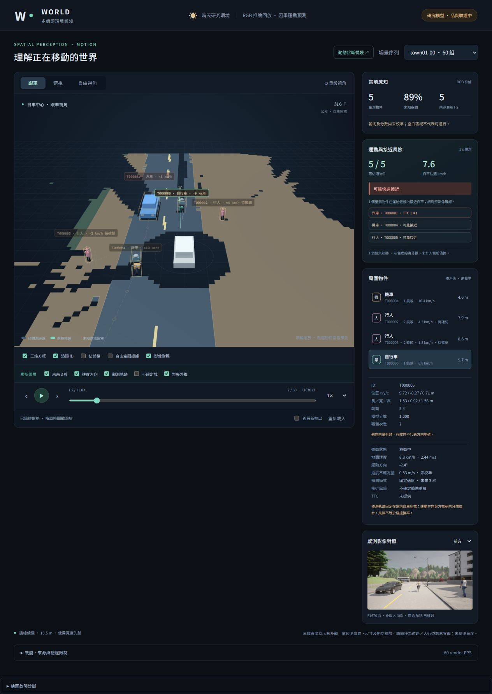
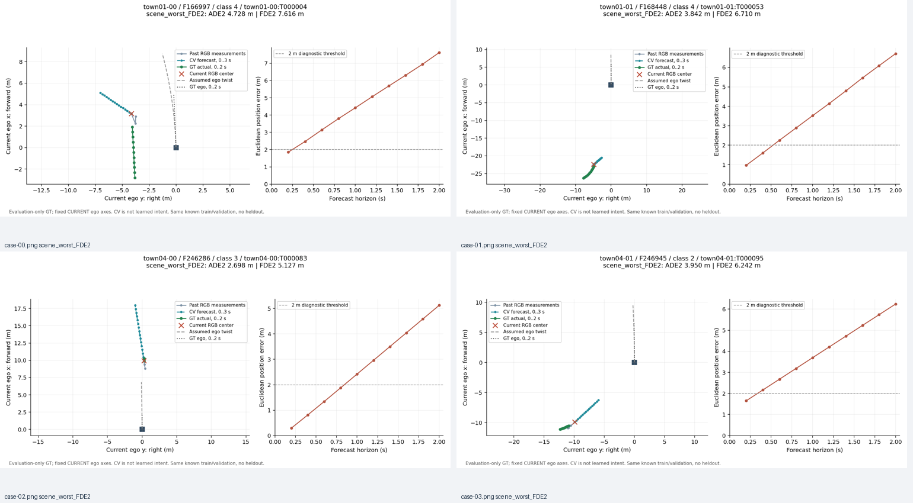

# Phase7：因果運動與三維動態展示（2026-10-20）

工程研究版完成；正式模型品質仍未通過。完整方法、數字、失敗與重現命令見 [REPORT.md](REPORT.md)。

- 主畫面為240組真RGB凍結感知推論，1091個物件／889次運動預測；GT幾何不進主場景。
- validation速度向量MAE .290m/s、ADE1 .950m、FDE2 1.205m；2秒GT覆蓋61.22%、all-GT miss47.52%。ID2同原版，無改善宣稱。
- 新關聯器v1(66 IDs)／v1.1(58)都差於原50，未採用。003離群計數問題修成004，原結果全部保留。
- 256 Python、40 JS、22 HTTP；真browser全部240組、889個實際WebGL軌跡buffer、4段完整播放；204個合成診斷影格另核對。CPU套用p9544.4ms／render60FPS，非即時感知。
- 合成跟車／轉彎／切入／急煞明標非RGB AI，不能代替新CARLA情境驗收。風險是保守circle接近、非校準碰撞機率；nominal recall50%，potential誤警很多。

`reports/`保存完整驗證、失敗及回歸log；`visual-QA/`保存8面板（7獨立例）、原catalog與另存實看收據；`screenshots/`含手機與故障恢復。

`runs-and-failed-experiments.zip`保存4版motion、3版evaluation、固定輸入inventory／上游JSON與source／合成trace；`viewer-display-without-RGB.zip`保存bundle與顯示JSON/bin；`browser-receipts.zip`保存240真browser與204合成DTO、最終checks及空console；`source-snapshot.zip`保存本輪最終程式與文件（含既有vendor授權）。每個ZIP有原bytes SHA inventory且已CRC／逐項SHA核對。

原1920RGB、權重及上游大型NPZ僅留本機ignored目錄，未放入Git；因此此封存可審閱、核對數字及來源，不是完整可攜推論資料集。未訓練／安裝新套件、未開dev/lockbox、未發車／控制。兩個測試服務與計算jobs交付前均停止。

封存manifest只證明檔案一致，不把研究成績改成正式pass。舊Phase3/4/5/6證據未修改。
