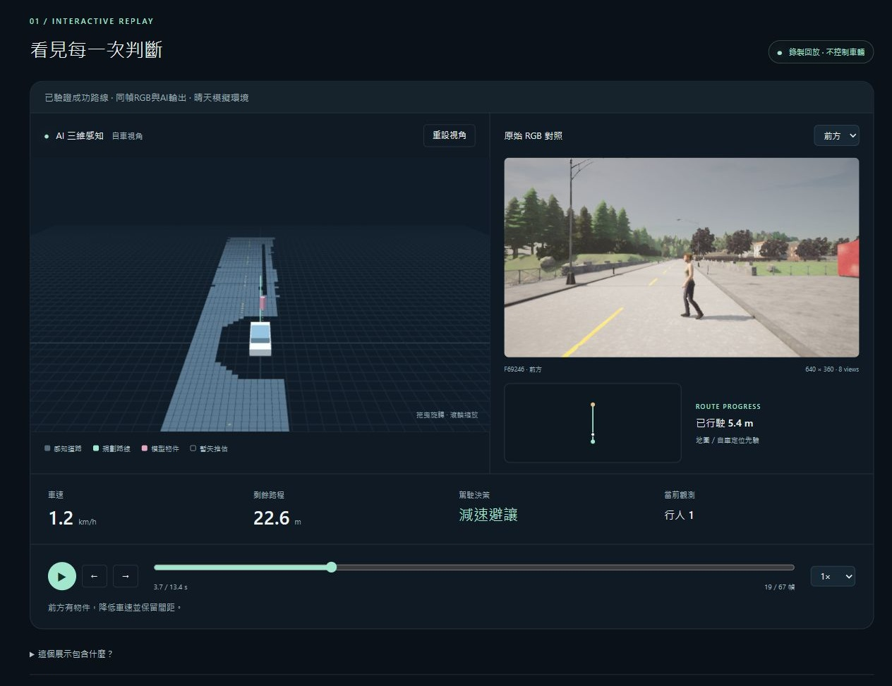

# 公開網頁展示交付（2026-10-21）

- [線上展示](https://annahung306.github.io/senior-ai-driving-demo/)
- [GitHub專案](https://github.com/AnnaHung306/senior-ai-driving-demo)
- [完整使用／部署說明](../../../WEB_DEMO.md)

已將成功的Town01晴天行人避讓28m案例，整理為67幀／536RGB預覽、同幀3D／模型輸出／規劃／控制的靜態網站，附13.4秒影片。main/docs由GitHub Pages提供HTTPS；觀眾不用CARLA、GPU、Python或套件。從Git匯出後，也可用Python標準HTTP服務開啟同一網站。

檢查包含全部靜態manifest bytes／影格來源、7個Node錯誤處理與契約測試、純Git HEAD匯出無原始artifacts、地方browser67幀逐一核對、自然完整播放、八鏡頭、鍵盤單幀、Orbit實際拖曳、375px無水平溢出，以及公開網站19HTTP關鍵資產SHA/MIME、八鏡頭、自然播放到ARRIVED、WebM實際播放與console無warn/error。

[雲端CI](https://github.com/AnnaHung306/senior-ai-driving-demo/actions/runs/39559840320)及[Pages部署](https://github.com/AnnaHung306/senior-ai-driving-demo/actions/runs/39559876097)在f0579ec成功。初次65b97b5的CI因舊data/忽略規則漏掉bundle而失敗；加精確例外、Git-index檢查、從乾淨匯出重驗後修正，不刪失敗歷史。Windows .mjs純文字MIME也在實測時發現，瀏覽器改用.js；docs/**保留bytes，避免Windows換行改壞SHA。

公開站只播放保存結果，不執行新模型、不提供車輛控制、不接受新目的地；地圖與ego定位是先驗，其他actor GT不加入主展示。JPEG為有損網頁預覽，不重算準確率。原Phase10及所有模型品質限制保持，不為展示改寫成功率。四權重與舊evidence不修改。

本輪使用既有Git Credential Manager登入；沒有顯示或另存token。既有個人GitHub首頁與lane-nav未修改；大型原始資料／權重保持ignored。只停止本機8780預覽，公開GitHub Pages持續在線。網站主程式與重要非同步／同幀／座標／資源生命週期均有註解。

release-validation與public HTTP／browser／cloud receipts分別證明相應範圍。desktop/public-desktop是完整真browser畫面的明示區域裁切，provenance保存原PNG SHA與rect；mobile是實看手機頁，原大型PNG保留local artifacts。manifest自排除；hash證明一致性，不表示模型可靠或所有錯誤皆已找出。
