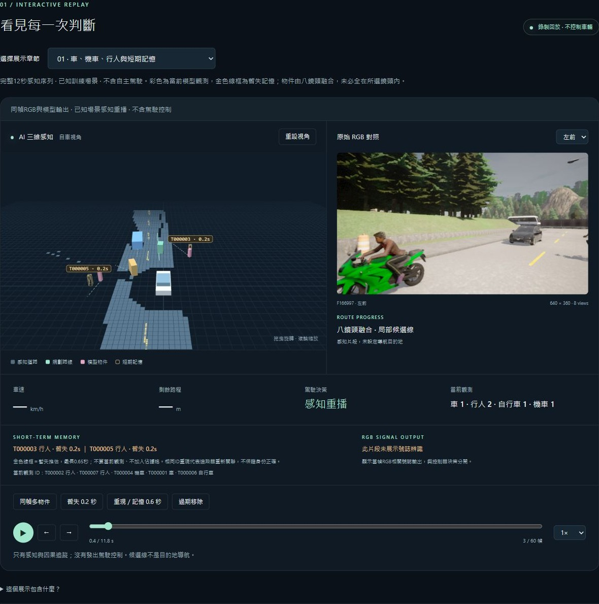
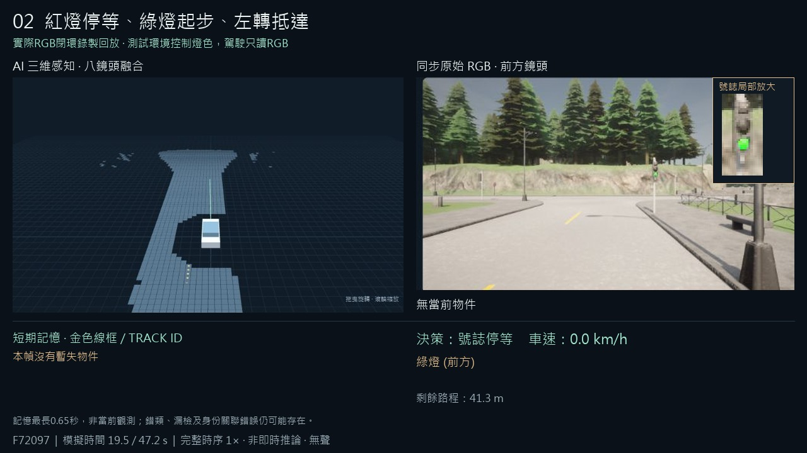

# 多物件、短期記憶與號誌左轉公開展示

2026-10-21。只擴充展示，沒有CARLA新採集、訓練、改權重、改原run或開啟development／lockbox評分。

網站：<https://annahung306.github.io/senior-ai-driving-demo/>。使用方式見 [WEB_DEMO.md](../../../WEB_DEMO.md)。

| 章節 | 來源 | 完整影格／RGB | 性質 |
|---|---|---|---|
| 多物件與記憶 | Phase7 bundle 的 town01-00 | 60／480 | 原訓練場景感知重播，不含控制 |
| 號誌與左轉 | phase10-drive-long-red-probe-v1-001 | 236／1888 | 已抵達的真RGB閉環錄製 |
| 原行人避讓 | phase10-drive-pedestrian-probe-v1-001 | 67／536 | 原已抵達閉環錄製，繼續保留 |

第一章30幀同時輸出car/person/motorcycle，37幀有暫失軌跡；只是模型輸出統計，不是準確率。T000003從觀測變成暫失0.2／0.4／0.6秒後移除，T000005於暫失後重新關聯。同ID不保證身份正確。原TTL0.65秒未更改，暫失物件不加入佔據格，沒有未來補幀或永久物件記憶。

第二章獨立director使環境紅燈，在靜止停等約15秒後切綠。driver只用RGB號誌；主畫面及局部放大均無燈色GT。F72097首次辨識綠、F72177解除停等，相差8秒，整段保留，不把較慢起步修飾成正常反應。最後自車yaw轉過約−1.44rad並ARRIVED，剩餘1.6m在原抵達容差內。

## 驗證與證據

- `source-audit.json`：363份record數值與原始JSON相等、原檔SHA及全部2,904個原PNG SHA通過。只轉JPEG預覽，沒有改類別、方框或軌跡。
- `browser-captures.json`：兩新章全部296次真瀏覽器逐幀截圖的當時DOM、鏡頭、影格及裁切座標；`video-receipt.json`記每張截圖SHA、同幀JPEG號誌ROI及影片SHA。
- `verification.json`、`browser-qa.json`：新296幀與原67幀實際操作、85次介面來源檢查；八鏡頭、記憶、播放到末幀、鍵盤seek、播放中快速切章、手機無水平溢出、號誌框只顯示匹配鏡頭。最終console無warn/error。
- `local-http.json`：46次實際GET，網站程式、三章資料、影片與四組八鏡頭bytes／MIME一致。
- 可攜標準函式庫完整性檢查＋11個Node測試；另外從完整Git index匯出至沒有artifacts的乾淨資料夾重做，結果另附收據。
- 59.2秒VP8/WebM，1280×720、5fps、296幀全部解碼通過。第0–12秒是感知，12–59.2秒是完整號誌左轉。沒有跳過紅燈、插值或音訊；另有原13.4秒影片保留於docs/media。

截圖已實看：`desktop.jpg`為第一章短期記憶，`mobile.jpg`為390px viewport的第二章，`green-signal.jpg`為同幀綠燈模型框。`video-start.jpg`可見車／機車／行人，`video-green.jpg`顯示綠燈但仍停等，`video-turn.jpg`顯示實際左轉。展示的模型錯誤、既有資料域及Phase10正式品質未過仍保留。

公開部署commit為 `707ba5e8cd7be25e83675c2619ac313d4c4b3348`，Pages及Static demo checks均成功（github-deployment.json）。46項公開HTTP內容／MIME與local manifest完全相符（public-http.json）；公開browser另18次狀態核對含八鏡頭、記憶、紅／綠燈、轉彎／抵達、原章及59.2秒影片實際播放至37秒，console無warn/error（public-browser.json）。公開截圖為public.jpg，來源原圖SHA及裁切位置在public-screenshot.json。

本機8080測試服務及測試tab已關閉，只保留公開展示頁；無CARLA、訓練或driver待續。本資料夾與舊github-pages-v1-001分開，不覆寫舊證據。
